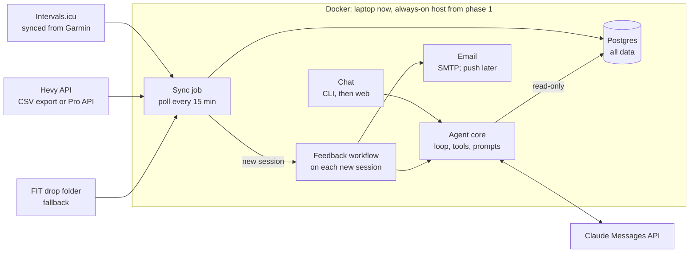

# Sasoi — Build Plan

## Goals and principles

Sasoi (Basque for being in good shape) is a personal agent that analyses my running and strength training. It is also how I put what I learned for the [Claude Certified Developer: Foundations](https://claude.com/blog/four-role-based-claude-certifications) certificate into practice.

It covers five areas: grounding models with data, building agentic systems, evaluation-driven development, operating in production, and machine learning foundations.

Rules that hold across all phases:

- The model plans and interprets; code computes. Every number in an answer comes from a tool result.
- Tracing from day one. No feature without traces to inspect.
- Evals decide what to build next, not this roadmap. Every phase ends with working software I use; there are no dates.
- Own loop over raw HTTP first; frameworks only after I know what they replace.
- Personal tool, built so it can be open-sourced later without cleanup.

## Use case, scope and data

A single-user, self-hosted training assistant. The most valuable feature is automatic feedback after every session with no manual step; chat and the training plan build on it. Combining runs and lifting, with numbers that are checked, is what existing Hevy MCP servers do not offer.

| Feature | What it does |
| --- | --- |
| Post-session feedback | After each run or strength session: summary, comparison with recent sessions, plan adherence, trend; sent by email |
| Chat | Questions about sessions, trends and how to improve; CLI first, then a web chat right after run feedback |
| Discuss a session | A "Discuss this run" link in each feedback email opens a chat with that session already loaded |
| Training plan | Uploaded or created with the agent (I approve); stored as structured data; adherence tracked |
| Weekly summary | Sunday email with load, adherence and trends |
| Plan adjustments | Agent proposes changes after missed sessions; I approve |
| Later | Weight, nutrition, sleep and HRV, extra integrations |

| Source | Access route | Cost and status |
| --- | --- | --- |
| Garmin (runs) | Intervals.icu API: a free account syncs from Garmin Connect; personal API key; polled | Free; preferred route; Garmin attribution required when displaying data; read full terms |
| Garmin (fallback) | FIT export from Garmin Connect, dropped into a watched folder | Free, manual |
| Hevy (strength) | CSV export from the app (Settings, Export & Import Data) | Free, manual; first route |
| Hevy (automated) | Official API with a key from Hevy Pro; polled | $2.99/month; only once strength feedback earns it |
| Strava | Not used | API terms prohibit using API data in AI applications |

In scope: analysing training and progression, answering questions, charts. Out of scope: medical or injury advice. Eval cases check the agent stays inside this line.

Ingestion is plain, deterministic code with no LLM involved.

Sources: [Strava API changes (TechRepublic)](https://techrepublic.com/article/news-strava-api-scraping-crackdown) · [Garmin developer API pause (the5krunner)](https://the5krunner.com/2026/09/14/garmin-developer-api-access-paused/) · [Hevy API setup (Serval docs)](https://docs.serval.com/sections/integrations/hevy) · [Hevy pricing (Recurdash)](https://recurdash.com/subscription-pricing/hevy) · [Hevy data export (Hevy help)](https://help.hevyapp.com/hc/en-us/articles/38001424401943) · [Intervals.icu API cookbook (forum)](https://forum.intervals.icu/t/intervals-icu-api-integration-cookbook/80090/17) · [Intervals.icu API terms (forum)](https://forum.intervals.icu/t/intervals-icu-api-terms-and-conditions/114087)

## Architecture

Phase 0 runs on the laptop; by the end of phase 1 the same containers move to an always-on host (likely a cheap VPS) so feedback arrives without the laptop being on. From phase 2, the web chat stores conversations in the same Postgres database. Every model and tool call in the agent core is traced. Feedback is a fixed workflow so every email is consistent; chat is an agent loop because its questions are open-ended.

## Roadmap

### Phase 0 · Foundations

**Goal:** learn to build an agent loop, then get my data into one place and talk to it.

**Build:**

- [x] ~~Get a Claude API key from the Claude Console (a Claude subscription does not include API usage)~~
- [ ] Agent loop (first deliverable, no fitness data yet): a chat CLI that talks to the Claude Messages API over raw HTTP
  - [x] ~~Conversation history~~
  - [x] ~~Two or three toy tools (e.g. current time, calculator) to learn the tool-use loop~~
  - [x] ~~A trace of every call~~
  - [x] ~~Stop-reason handling~~
  - [x] ~~Retries with backoff~~
  - [ ] Tokens and cost per turn
- [ ] Data access spike (go/no-go): create an Intervals.icu account, connect Garmin Connect, confirm a recent run arrives with laps and heart rate, and fetch it with curl using the personal API key; export Hevy workouts to CSV and check it has sets, reps, weight and dates; check whether Hevy workouts also reach Garmin Connect. If a route fails, step down the ladder: API, then export files, then screenshots read by a vision model.
- [ ] Ingestion: pull Intervals.icu activities and the Hevy CSV export into Postgres; inspect the data (exercise naming, units, time zones) before designing the schema
- [ ] Data tools: add a read-only `run_sql` tool and the schema description to the loop; Dockerfile and compose file
- [ ] First evals: 15–20 real questions, each with a hand-written SQL query as ground truth; run the agent and read every trace
- [ ] Two eval datasets: a frozen, gitignored snapshot of my data, and a small synthetic set in the repo for CI and demos

**Ships:** a chat CLI on my laptop that answers questions about my runs and lifts.

**Done when:** data access is confirmed, and I have a baseline eval score and a list of failure categories.

### Phase 1 · Run feedback

**Goal:** an email after every run, with no manual step.

**Build:**

- Sync job polling Intervals.icu, plus a processed-sessions table so nothing is sent twice
- Feedback workflow: context pack, write, validate the numbers, send
- Feedback evals: numbers checked by code, usefulness and tone scored by an LLM judge
- Move to the always-on host, with images built for both amd64 and arm64 so the app runs on an x86 or ARM VPS and later on a Raspberry Pi
- Tracing tool with a browser UI, replacing the JSONL traces (see open decisions)

**Ships:** feedback in my inbox after every run.

**Done when:** three real runs in a row produce correct feedback without me touching anything.

### Phase 2 · Web chat

**Goal:** talk to the assistant from my phone, starting from any session's feedback.

**Build:**

- Streaming in the agent loop, used by both the CLI and the web chat
- Minimal web app on the always-on host: one chat page with streaming and a list of past conversations
- A "Discuss this run" link in each feedback email that opens a new conversation loaded with that session's context pack
- Conversations stored in the same Postgres database
- Access through Tailscale, not exposed publicly
- Eval cases for follow-up questions that start from a session

**Ships:** a web chat I can open from a feedback email on my phone.

**Done when:** I can tap the link in a run's email and ask follow-up questions about that run from my phone.

### Phase 3 · Strength feedback

**Goal:** the same feedback for strength sessions.

**Build:**

- Strength context pack: volume, top sets, estimated 1RM, comparison with recent sessions
- Input: a fresh Hevy CSV export dropped in a folder, or the Hevy API if Pro is worth paying for
- Strength cases added to the feedback evals

**Ships:** feedback after every strength session.

**Done when:** strength feedback passes its evals and the Hevy Pro decision is made. Until Pro, each session needs a manual CSV export.

### Phase 4 · Evals and agent hardening

**Goal:** change prompts, models and code without breaking what works.

**Build:**

- Eval set grown to about 50 cases, error analysis on traces
- LLM judge checked against my own labels
- Prompt caching, context management, step and budget guards
- Evals run on every prompt or model change

**Ships:** a regression suite I trust, and cheaper, faster runs.

**Done when:** no change ships without the suite passing.

### Phase 5 · Grounding

**Goal:** more accurate chat answers.

**Build:**

- Generated SQL compared with dedicated metric tools on query accuracy evals

**Ships:** better chat answers.

**Done when:** the grounding approach is chosen on eval evidence.

### Phase 6 · Training plan

**Goal:** feedback that knows what I was supposed to do.

**Build:**

- Plan schema: weeks, sessions, targets
- Upload: a markdown or PDF plan extracted into the schema with structured outputs
- Matching each session to its planned session, and adherence in the feedback
- Prompt injection review: uploaded plans are untrusted input

**Ships:** feedback that says how each session fits my plan.

**Done when:** extraction and matching accuracy are measured on evals and good enough to trust.

### Phase 7 · Agent features

**Goal:** the assistant does more on its own, with me approving anything that changes the plan.

**Build, one feature at a time:**

- Weekly summary email
- Plan creation, with my approval before it is stored
- Plan adjustments after missed sessions, with my approval
- MCP server exposing the tools
- Jev spike: classifying run type for plan matching ([Jev](https://en.wikipedia.org/wiki/Jev_(AI_model)) is a discriminative model: it returns typed, calibrated predictions rather than generated text)

**Ships:** each feature as soon as it passes its evals.

**Done when:** each addition earns its cost on the evals.

### Phase 8 · SDK comparison

**Goal:** know what the Claude Agent SDK does for me.

**Build:** port the agent to the Agent SDK and run the same evals on both versions.

**Ships:** the agent on whichever version wins.

**Done when:** the keep-or-drop decision is made on evidence.

### Phase 9 · Production hardening

**Goal:** usable from anywhere, safely and cheaply.

**Build:**

- Charts in the web chat
- Other delivery channels: ntfy push notifications (works without Google services), Telegram bot for two-way chat
- Secrets review
- Cost budgets and model routing (Haiku vs Sonnet per step)
- Local models experiment
- Online evals and alerts

**Ships:** the assistant running unattended, safely and cheaply.

**Done when:** alerts fire when quality drops.

## ML foundations, just in time

No course. Learn the slice of ML that makes the other areas better, when a phase needs it.

| Topic | Needed in | Why |
| --- | --- | --- |
| Classification metrics (precision, recall, F1, confusion matrices) | Phases 4–6 | Graders, query accuracy, plan extraction, session matching |
| Statistics on small eval sets (variance across runs, confidence intervals) | Phase 4 | Telling a real gain from noise |
| Dataset hygiene (no tuning prompts on test cases) | Phase 4 | Eval results that mean something |
| Calibration (reliability diagrams, ECE) | Phase 7 | Testing Jev's calibration claim |
| Fine-tuning and training, conceptually | Any time | Knowing when it beats prompting or retrieval |

Going deeper, such as training models from scratch, is a separate decision for later.

## Open decisions and risks

| Item | Type | Decide by | Notes |
| --- | --- | --- | --- |
| Garmin data access | Risk | End of phase 0 (spike) | Intervals.icu (free) is the main route; fallbacks: FIT export from Garmin Connect, then screenshots read by a vision model |
| Hevy data access | Risk | End of phase 0 (spike) | Free CSV export first; Pro API only for automation; screenshots as last resort |
| Intervals.icu terms | Risk | End of phase 0 (spike) | Read the full API terms before relying on it |
| Always-on host | Decision | End of phase 1 | Needed for triggers and the web chat; leaning to a cheap VPS (no spare machine at home); compare providers when deciding, as prices moved a lot in 2026. Later, if the project proves its value, move to a Raspberry Pi or similar cheap home machine |
| Tracing tool | Decision | End of phase 1 | Depends on the always-on host: self-hosted on it (e.g. Phoenix, Langfuse) vs SaaS; traces contain health data. JSONL files plus `scripts/trace.sh` until then; OpenTelemetry keeps the backend swappable |
| Hevy Pro | Decision | End of phase 3 | One month at $2.99 to automate strength feedback; keep it only if it earns it |
| Jev spike | Decision | End of phase 7 | Discriminative model vs an LLM; candidate use: classifying run type for plan matching |
| Local models | Decision | End of phase 9 | Which steps can run on Ollama |
