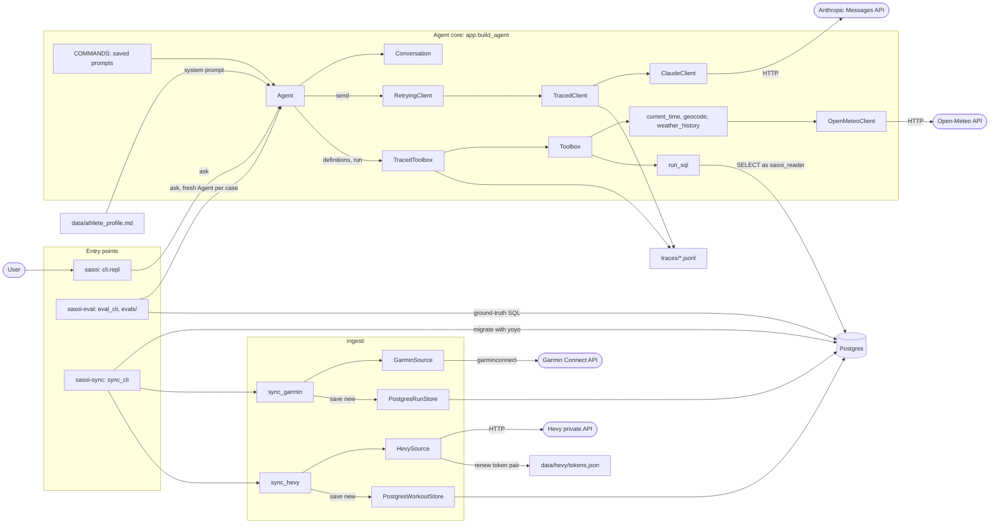

# Architecture

- The Claude client is raw HTTP, with no Anthropic SDK, by design. Errors are `ClaudeError`: `ClaudeConnectionError` or `ClaudeApiError`.
- `RetryingClient` retries only connection errors, 429 and 5xx, and honours `retry-after` up to `MAX_WAIT_SECONDS`.
- `repl` only does terminal I/O; tests inject `read`/`write`.
- Config loaders raise `SettingError`; each `main` formats it for its output. Unknown models show tokens only, no dollars.
- The agent reads Postgres only as `sasoi_reader`, through a read-only `run_sql` that returns at most `MAX_ROWS`. The schema description lists only tables with a comment.
- Sync stores only sessions not yet stored (Garmin: latest `SASOI_GARMIN_LIMIT`), so backfill and incremental sync are the same code.
- `garmin_mapping.py` and `hevy_mapping.py` are allow-lists: fields not mapped are never stored.
- Garmin login may prompt for email, password and MFA. Hevy's `/login` needs a reCAPTCHA token, so `hevy_login` prompts once for a token pair copied from the web app.
- Sync logs to stdout at `SASOI_LOG_LEVEL`; third-party loggers stay at WARNING.
- Evals run cases in parallel, each with its own reader connection and trace in `traces/evals/<timestamp>/<repeat>/`. A case passes when one of the agent's `run_sql` results contains every row of the ground-truth query (columns in any order, numbers within rounding or a unit scale).
